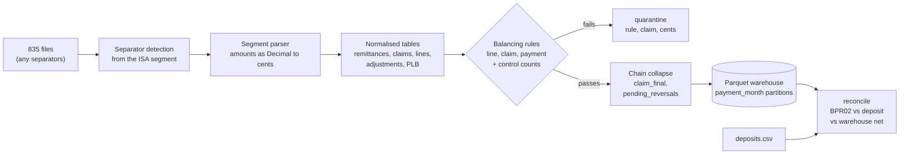

# era835

[](https://github.com/SlateGitOrg/era835/actions/workflows/ci.yml)


era835 loads X12 835 remittance files (ERAs) into a Parquet warehouse. It parses a defined subset of the format into integer cents, rejects any remittance that does not satisfy the line, claim and payment balancing rules, collapses reversal and correction chains into one final row per patient control number, and reconciles the warehouse to bank deposits to the cent. Everything in the repository, including the sample data, is synthetic.

## The problem

Physician groups and revenue-cycle vendors load payer remittances into a warehouse to track denials and net collections. Three things go wrong with a naive load:

- Payers send reversals and corrected claims weeks later. Treating every `CLP` segment as a claim counts a corrected claim three times (original, reversal, correction).
- Keeping the last row per claim depends on file delivery order, and can leave a paid claim showing as reversed.
- A parse slip in an adjustment segment moves dollars between contractual write-off and patient responsibility without any error.

Finance then cannot tie the warehouse to the EFT deposits on the bank statement, and denial dashboards get argued about instead of acted on. era835 makes the tie-out a property of the load: a remittance either balances exactly and is loaded, or it is quarantined with the rule it broke and the difference in cents.

## How it works



**Tokeniser.** The ISA segment is fixed width, so the separators are read from it: the element separator is character 4, the component separator is ISA16 and the segment terminator is the next character. Files may or may not have newlines after the terminator, and one payer in the sample data uses `|`, `^` and newline-terminated segments.

**Parser.** Supported segments: ISA/IEA, GS/GE, ST/SE, BPR, TRN, DTM, N1, CLP, CAS, NM1, SVC, AMT, PLB. Other segments are ignored but counted by SE01. Element meanings used:

| Element | Meaning |
|---|---|
| BPR02 | Total provider payment |
| TRN02 | EFT or check trace number |
| CLP01 | Patient control number |
| CLP02 | Status: 1 primary, 2 secondary, 4 denied, 22 reversal of previous payment |
| CLP03 / CLP04 / CLP05 | Total charge / payment / patient responsibility |
| CLP07 | Payer claim control number |
| CAS01 | Group code (CO, PR, OA, PI, CR), followed by up to six (reason, amount, quantity) triplets |
| SVC01 | Composite procedure code (`HC:99213:25`) |
| SVC02 / SVC03 / SVC05 | Line charge / paid / units |
| AMT (B6) | Line allowed amount |
| PLB | Provider-level adjustments as (reason composite, amount) pairs |

In a PLB pair a positive amount reduces the payment (`WO`, recoupment) and a negative amount increases it (`L6`, interest). CAS segments before the first `SVC` of a claim are claim-level, those after an `SVC` belong to that line.

**Balancing rules.** All sums are over integer cents, and `difference_cents` is always computed minus reported.

| Rule id | Equation |
|---|---|
| `line_balance` | `SVC02 - sum(line CAS) = SVC03` |
| `claim_balance` | `CLP03 - sum(claim CAS) - sum(line CAS) = CLP04` |
| `payment_balance` | `BPR02 = sum(CLP04) - sum(PLB)` |

Control checks use the rule ids `segment_count` (SE01 against the segments from ST to SE), `transaction_control` (SE02 against ST02), `group_count` and `group_control` (GE01, GE02), `interchange_count` and `interchange_control` (IEA01, IEA02). An unparseable body or file is `parse_error`, and the same EFT arriving in a second, different file is `duplicate_trace`. A failure in a transaction quarantines that transaction; a failure in the GE or IEA trailer quarantines every transaction it covers. A GE or IEA fault in a group or interchange that holds no transaction at all is quarantined at file level (no remittance id), and an interchange with no ST/SE is `no_transactions`. Quarantined remittances put no rows in any warehouse table. The `duplicate_trace` rule is order dependent: if two different files carry the same payer and trace number, whichever loads first is kept and the other is quarantined (the synthetic data never does this).

**Chain collapse.** `claim_final` has one row per patient control number: net paid, net patient responsibility, final status and chain length. A reversal cancels the payment with the same payer, CLP01 and CLP07. Among payments that are not reversed, the latest by payment date supersedes earlier ones from the same payer. A reversal whose original has not been loaded sits in `pending_reversals` and is left out of `claim_final` until the original arrives. The result depends only on the set of events, not on load order.

**Warehouse.** Tables are written with pyarrow as `warehouse/<table>/payment_month=YYYY-MM/part-0.parquet`, sorted by key, so the same input always produces the same bytes. A ledger keyed by ISA13 plus the file's sha256 makes a re-delivered file a no-op. Tables: `remittances`, `claims`, `claim_adjustments`, `service_lines`, `line_adjustments`, `provider_adjustments`, `claim_events` (append-only, with the load sequence), `claim_final`, `pending_reversals`, `ledger`, `quarantine`.

### Synthetic data

`era835 generate` writes about 40 files over four months for six fictional payers: 3,000 claim segments, 7,617 service lines, CARC codes CO-45, PR-1, PR-2, PR-3, CO-97, CO-16, CO-50 and OA-23, and these injected patterns, all recorded in `truth.json`: 120 reversal-plus-correction chains (some in one file, some two to six weeks apart), 15 original files delivered after the files that reverse them, 4 PLB adjustments (2 L6 interest, 2 WO recoupments), 3 files with one altered CAS amount, 1 file with a wrong SE01, 1 file delivered twice and 1 payer using `|`, `^` and newline-terminated segments. The malformed files contain no chain claims. Provider, payer and patient identifiers are invented.

## Quick start

```bash
python3 -m venv .venv
.venv/bin/pip install -e ".[dev]"

.venv/bin/era835 generate --out data                 # 41 files, deposits.csv, truth.json
.venv/bin/era835 load data/files -w warehouse        # files load in name (delivery) order
.venv/bin/era835 reconcile --deposits data/deposits.csv -w warehouse --month 2026-01
.venv/bin/era835 quarantine -w warehouse
.venv/bin/era835 denials -w warehouse                # add --by payer for reason within payer
```

`reconcile` exits with status 1 if any loaded EFT differs from its deposit, has no deposit, or a deposit has no remittance, or the trace number is shared by two payers. Quarantined remittances are listed as `quarantined`, not as differences.

## Example output

All of this is produced by the commands above on the seeded data (`--seed 835`).

```text
$ era835 load data/files -w warehouse
file                    status       loaded  quarantined
----------------------  -----------  ------  -----------
001_ald01_20260105.835  quarantined       0            1
002_brw02_20260106.835  quarantined       0            1
016_brw02_20260210.835  duplicate         0            0
021_brw02_20260301.835  quarantined       0            1
031_elm05_20260401.835  quarantined       0            1
41 files: 36 loaded, 0 partial, 4 quarantined, 1 duplicate
warehouse: 2710 claims, 2470 final claims, 0 pending reversals
```

The generator writes 3,000 claim segments; 2,710 are in `claims` after quarantine. `claim_final` has 240 fewer rows, one reversal and one correction for each of the 120 chains.

Reconciliation for January (BPR02, bank deposit and warehouse net are in dollars, the difference is in cents):

```text
$ era835 reconcile --deposits data/deposits.csv -w warehouse --month 2026-01
trace            payer                          BPR02     deposit  warehouse net  diff (cents)  status
---------------  ------------------------  ----------  ----------  -------------  ------------  -----------
EFT020260105220  Alder Mutual Health       $44,470.50  $44,470.50              -             -  quarantined
EFT020260123906  Alder Mutual Health       $25,271.55  $25,271.55     $25,271.55             0  tied
EFT120260106197  Brightwater Health Plan   $29,337.37  $29,337.37              -             -  quarantined
EFT120260125360  Brightwater Health Plan   $32,823.25  $32,823.25     $32,823.25             0  tied
EFT220260105472  Cobalt Ridge Benefits     $43,364.76  $43,364.76     $43,364.76             0  tied
EFT220260124468  Cobalt Ridge Benefits     $26,690.81  $26,690.81     $26,690.81             0  tied
EFT320260104628  Dunmore Care Partners     $22,968.78  $22,968.78     $22,968.78             0  tied
EFT320260120365  Dunmore Care Partners     $25,035.89  $25,035.89     $25,035.89             0  tied
EFT420260110355  Elmstead Health Alliance  $35,181.82  $35,181.82     $35,181.82             0  tied
EFT420260124166  Elmstead Health Alliance  $37,499.41  $37,499.41     $37,499.41             0  tied
EFT520260106759  Fennel Valley Insurance   $30,886.25  $30,886.25     $30,886.25             0  tied
EFT520260122294  Fennel Valley Insurance   $30,301.74  $30,301.74     $30,301.74             0  tied
```

Quarantine list. Three files have one claim-level CAS amount altered, so the claim is out of balance by the number of cents shown; one file declares the wrong SE01 count:

```text
$ era835 quarantine -w warehouse
file                    rule           claim      cents
----------------------  -------------  ---------  -----
001_ald01_20260105.835  claim_balance  PC1000194    894
002_brw02_20260106.835  segment_count  -              -
021_brw02_20260301.835  claim_balance  PC1000812    670
031_elm05_20260401.835  claim_balance  PC1002381    910
```

Top denial reasons by dollars (claims whose final status is denied; CAS amounts under each reason):

```text
$ era835 denials -w warehouse
reason  claims      denied
------  ------  ----------
CO-50       95  $50,338.82
CO-16       47  $28,151.40
CO-97       10   $5,612.52
```

## Design decisions

- **Integer cents from the parser onward.** Amounts are parsed with `Decimal` and rejected if they have more than two decimal places, so a malformed amount is a `parse_error` rather than a silently rounded figure. Quantities and units are the exception: they are kept as the text received because they never enter a money calculation.
- **Quarantine, never repair.** A remittance that fails a rule is stored with the rule id, the claim and the exact difference, and none of its rows reach the warehouse. The cost is that one bad claim holds back its whole remittance (every claim in it), which matches how the EFT is deposited as a single amount; the benefit is that the warehouse never holds a figure that cannot be tied to the bank.
- **Chain collapse from the event set, not file order.** `claim_final` is recomputed from all claim events on each load. That makes it order independent and lets a pending reversal resolve when its original arrives, at the price of recomputing the derived tables on every load (cheap at this size, but it is a full rewrite rather than an incremental update). A reversal matches on payer, CLP01 and CLP07 together, so a reversal that points at the wrong patient control number stays pending where someone can see it.
- **Whole-table deterministic rewrite with a commit point.** Each load stages every table under `.staging`, then commits by renaming that directory to `.pending` in one step, then swaps the tables into place and removes `.pending`. The swap is idempotent, so a crash after the commit is rolled forward the next time the warehouse is opened, and a crash before it leaves the previous state untouched (a test interrupts every rename and checks the retry ends where a clean load ends). Individual swaps are not atomic together: a concurrent reader during the roll-forward window can see some tables from the new load and some from the old one, so this assumes a single writer. Rows are sorted and file names fixed, so identical input gives byte-identical output. The cost is that every load rewrites every table, which would not scale to very large warehouses the way appending partitions would.
- **Reconcile from warehouse tables, not from BPR02.** Warehouse net paid is recomputed from the stored `claims` and `provider_adjustments` rows, so the check also catches a defect in the load itself rather than only restating the file's own total. Rows are keyed by payer and trace number; the deposit file has only a trace number, so if two payers share one the rows are reported as `ambiguous_trace` instead of being matched to the wrong deposit.
- **A strict subset of the 835.** Only the segments listed above are interpreted. Anything else is counted but ignored, which keeps the balancing rules unambiguous but means features such as claim-level supplemental amounts or LX grouping are not modelled.

## Testing

```bash
.venv/bin/python -m pytest -q
uvx ruff check . && uvx ruff format --check .
```

The tests run offline. Unit tests cover the tokeniser, parser, money handling, each balancing rule and each control check, chain collapse in every arrival order and the warehouse (layout, byte-identical output, ledger, partial files, pending reversals, a crash injected at every rename of a load, and envelope faults in files with no transactions). Pipeline tests load the seeded synthetic set and check it against `truth.json`: every injected malformation is quarantined under the right rule with the recorded cents, every chain's net paid equals the truth, loading in delivery order and in reverse gives identical `claim_final`, every loaded EFT ties to its deposit, and denial totals equal the injected totals. Baseline tests show a naive load has exactly 240 more claims than `claim_final` and that last-row-per-claim totals differ between delivery and reverse order.

## Project layout

```text
src/era835/
  tokenizer.py   separator detection and segment splitting
  parser.py      835 subset parser (models.py holds the data classes)
  money.py       Decimal to integer cents, formatting
  validate.py    control checks and balancing rules
  normalize.py   parsed remittance to table rows
  chains.py      reversal and correction collapse
  warehouse.py   ledger, loader, deterministic Parquet writer
  schemas.py     table schemas, sort keys, partitioning
  reconcile.py   EFT / deposit / warehouse tie-out
  denials.py     denials by CARC reason and payer
  synth/         seeded generator, X12 writer, ground truth
  cli.py         era835 generate | load | reconcile | denials | quarantine
tests/           unit, pipeline and CLI tests; fixtures/ holds one remittance in two syntaxes
```

## License

MIT. See `LICENSE`.
